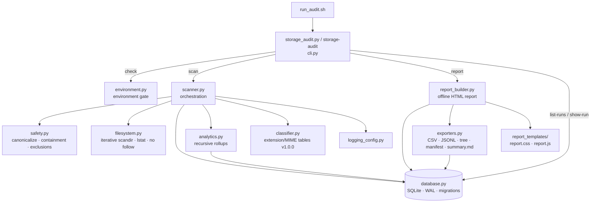

# Architecture

Android Storage Audit V1 — component overview, data flow and design
trade-offs. Measured against the master specification §4; deviations (none
material) are listed at the end.

## Component diagram



## Module responsibilities

| Module | Responsibility |
|---|---|
| `storage_audit.py` | Entry point; delegates to `storage_audit.cli:main`. |
| `storage_audit/cli.py` | Argument parsing, exit codes (0 ok · 1 unexpected · 2 usage/preflight · 3 gaps/cancelled · 4 report failure), `check`/`scan`/`report`/`list-runs`/`show-run`. |
| `storage_audit/environment.py` | Termux detection, state-dir resolution, volume stats, preflight writability probe. Never decides scan scope — only reports. |
| `storage_audit/safety.py` | Path canonicalization, containment (`is_within`), `safe_relpath`, scan-root validation, output-location policy, exclusion checker builder, output-inside-root exclusion. |
| `storage_audit/filesystem.py` | Traversal engine: iterative `os.scandir`, `os.lstat`, symlink detection (never followed), mount-boundary guard (via device id), per-entry `stat_status`, graceful cancellation event, environment collection. |
| `storage_audit/scanner.py` | Run lifecycle: create run row → traverse → batch-flush → reconcile counters → integrity check → status transition. Wires exclusions (output dir, DB files under root). |
| `storage_audit/classifier.py` | Filename-only classification: extension split (dotfiles, compound `.tar.gz`, trailing-dot, case-insensitive), documented category table, MIME guess, `CLASSIFICATION_VERSION = 1.0.0`. |
| `storage_audit/database.py` | SQLite schema (v1), forward-only migrations, WAL, FKs, whitelisted column updates, status-transition validation, `integrity_check`, stale-PID recovery, parameterized queries only. |
| `storage_audit/analytics.py` | Recursive directory rollups (`directory_stats`), empty-directory detection, same-size candidate groups. |
| `storage_audit/exporters.py` | `files.csv`, `directories.csv`, `scan_issues.csv`, `file_types.csv`, `entries.jsonl`, `directory_tree.txt` (chunked > 8 MiB), `summary.md`, `README.md`, `manifest.json` (SHA-256). CSV injection neutralization. |
| `storage_audit/report_builder.py` | Dashboard + paginated detail pages + search page (inline ≤ 30k entries, else `data/inventory_NNN.js` chunks) + static file tables + exports page. Atomic writes. Metric definitions single-sourced in `METRIC_DEFINITIONS`. |
| `storage_audit/report_templates/report.css` | Dark-first premium theme, responsive, reduced-motion aware. |
| `storage_audit/report_templates/report.js` | Client-side search/filter/sort/pagination for `files.html`; composes filters with AND; no dependencies; loaded with `defer`. |
| `tests/` | 110 unittest tests; synthetic fixtures only; never touches real storage. |
| `tools/benchmark.py` | Measured performance report generator. |

## Data flow

`scan` pipeline, in order:

1. **Preflight** — resolve requested root (`--root` → `STORAGE_AUDIT_ROOT` →
   `~/storage/shared`); canonicalize; refuse missing/unlistable roots
   (exit 2); detect Termux vs. development host (labelled).
2. **Output validation** — output dir vs. root containment
   (`check_output_location`); exclusions recorded on the run row.
3. **DB connect & migrate** — WAL, FK, `synchronous=FULL`; forward-only
   migrations; newer schema refused.
4. **Stale-run recovery** — any `running` row whose PID is dead becomes
   `interrupted_or_recovered`; alive PIDs untouched.
5. **Traversal** — iterative stack; per entry: lstat → classify → batch row.
   Directories: descend unless symlink or device-boundary. Symlinks:
   recorded, never followed. Errors: recorded as `scan_issues`, traversal
   continues.
6. **Batched flush** — every N entries (default 500) one transaction.
7. **Finalize** — reconcile counters from persisted rows; `integrity_check`;
   compute status (`completed` only if zero issues, zero skips, traversal
   finished, integrity OK; else `completed_with_gaps`/`failed`); persist
   counters; compute `directory_stats`.
8. **Report** (on demand) — reads DB only; never touches the filesystem
   tree; atomic page/export writes; `manifest.json` reconciles everything.

## Traversal algorithm & symlink policy

```
stack = [root]
while stack:
    dir = stack.pop()
    for entry in scandir(dir):        # one directory at a time
        lstat(entry)
        if symlink or device != root_device: record; continue
        if directory: pending_dirs.append(entry)
        else: record metadata row
    for sub in reversed(pending_dirs):  # push subdirs, deepest-first
        stack.append(sub)               # keeps traversal order deterministic
```

- **Symlinks are never followed** — loops and root escapes are impossible
  by construction; broken symlinks produce issues, not crashes.
- **Mount boundary** — traversal does not cross `st_dev` changes from the
  root device (DECISIONS.md #3); mount points are recorded, not traversed.
- **Cancellation** — `Ctrl+C` sets a threading event; the traversal checks
  it between entries; the current batch commits; the run is finalized as
  `cancelled` with `coverage_incomplete=1`. No resume in V1 by design.

## SQLite schema (v1)

Tables (see `database.py` for full DDL):

- `scan_runs` — one row per run; counters, status, environment JSON,
  exclusions JSON, coverage fields, report bookkeeping.
- `entries` — every inventoried entry; `UNIQUE(scan_id, relative_path)`;
  FK → `scan_runs` `ON DELETE RESTRICT`; indexed on
  `(scan_id)`, `(scan_id, kind)`, `(scan_id, parent_relative_path)`,
  `(scan_id, normalized_name)`, `(scan_id, extension)`,
  `(scan_id, category)`, `(scan_id, size_bytes)`.
- `scan_issues` — per-issue rows with operation/category/message;
  `(scan_id)` indexed; FK restrict.
- `directory_stats` — recursive rollups per directory (bytes, counts,
  depth); recomputed from `entries`.
- `report_builds` — report generation audit log.
- `schema_migrations` — applied migration versions.

Journal: WAL. Sync: `FULL`. FKs: enforced. All writes inside `with conn:`
transactions. All statements parameterized; column-name interpolation only
from closed whitelists (`_TRANSITION_COLUMNS`, `update_counters` map).

## Metric definitions (single source of truth)

Defined in `report_builder.METRIC_DEFINITIONS` and rendered verbatim in the
report's Methodology page:

- **Directory logical bytes** = Σ logical bytes of descendant regular
  files. Directory `st_size` is never used.
- **Directory file count** = Σ descendant regular files.
- **Empty directory** = enumerated directory with zero child entries
  (success is evidenced; an unreadable directory is NOT empty).
- **Grand total** = Σ logical bytes of all regular files (counted once).
- **Same-size candidate** = ≥2 regular files with equal size; a *hint*,
  never proof of duplication (no hashing in V1).
- **Inventoried vs OS-reported used bytes** — different denominators;
  sparse files make inventoried bytes exceed on-disk usage; always labelled.

## Output generation & pagination

- Detail pages: 500 rows/page (configurable), generated statically from DB.
- `files.html`: search UI; inventory JSON inline (≤ 30,000 entries) or
  `data/inventory_NNN.js` chunks (4,000/chunk) above that; noscript fallback
  links to the static pages.
- All pages: consistent shell (sidebar nav, header badge, footer with run
  id), skip link, ARIA roles, `aria-current` on the active page.
- Atomic writes: temp file in the same directory + `os.replace`.
- Tree export chunked at 8 MiB with `directory_tree_index.txt`.
- `manifest.json`: SHA-256 + byte size of every other export; lists scan id.

## Cancellation & error model

- Errors are **data**: permission-denied, vanished files, and unreadable
  directories become `scan_issues` rows with operation/category/message —
  the scan continues, and the run finishes `completed_with_gaps` (or
  `cancelled`/`failed`).
- Statuses: `running` → (`completed` | `completed_with_gaps` | `cancelled` |
  `failed`), plus `interrupted_or_recovered` from stale-PID recovery at next
  startup. Terminal statuses are immutable.
- Report success is tracked separately from scan success (`report_state`);
  reports are regenerable from any historical run without rescanning.

## Performance trade-offs

- Batched commits (default 500, range 50–5000): crash-resume granularity vs.
  per-file fsync cost — WAL + batching wins.
- Inline JSON ≤ 30k entries: single-file report works offline; beyond that,
  chunks keep the HTML payload manageable.
- `directory_stats` recomputed per export: O(entries), simple, correct; cheap
  at V1 scale.
- No hashing anywhere by default: avoids reading file contents entirely
  (privacy + speed), at the cost of exact duplicate detection (deferred to
  V1.1 as opt-in, per roadmap).

## Deviations from master §4 architecture

None material. The single deliberate scope decision: **V1 does not implement
scan resume** after an interruption (partial runs are kept, marked, and
reported as incomplete; rerunning starts a fresh run). This matches master
§5.6 intent and DECISIONS.md; documented in GAP_REGISTER (gap G-004).
